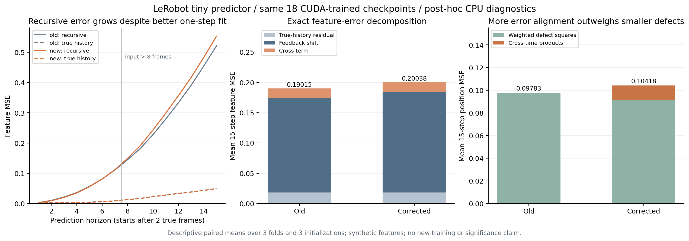

# VLA-JEPA paired RoPE study

A reproducible component contribution accompanying
[LeRobot PR #4835](https://github.com/huggingface/lerobot/pull/4835):
18 paired CUDA training runs, frozen checkpoints, selected mathematical checks,
and post-hoc mathematical diagnostics of worse long recursive prediction.
The candidate correction is credited to its author; this study contributes
validation and diagnostic evidence rather than a new RoPE algorithm.

**Result:** the corrected tiny predictor improves the original 8-frame
teacher-forced feature MSE by 6.03%, but worsens 15-step recursive feature MSE
by 5.38%. Exact error decompositions explain how better local errors can
accumulate into worse long predictions. Results are synthetic, descriptive
and mixed; they do not establish pretrained VLA or robot improvement.

Read [REPORT.md](REPORT.md) for the mathematics and detailed interpretation.



## Files

| File | Purpose |
|---|---|
| `experiment.py` | Unchanged script used for all formal CUDA training |
| `diagnose_rollout.py` | Frozen-checkpoint interventions and exact error identities |
| `plot_diagnostics.py` | Rebuild the scientific figure; requires matplotlib |
| `verify_artifacts.py` | SHA256/size/CRC/path/checkpoint/pair checks; executes no archived scripts |
| `results.zip` | Original training logs, curves, configuration, code bundle and metadata |
| `checkpoints.zip` | Original 18 formal plus 2 pilot and 2 smoke checkpoints |
| `diagnostics.zip` | Full per-run/per-episode CPU diagnostics and horizon CSV |
| `diagnostics-summary.json` | Readable aggregate of all 18 frozen-checkpoint diagnoses |
| `training-report.txt`, `training-summary.json` | Byte-identical original formal report/summary |
| `checksums.json`, `archive-manifest.json` | Original archive/payload provenance |
| `publication-checksums.json` | SHA256/size of the published package, excluding itself |
| `artifact-verification.json`, `independent-review.json` | Local automated verification results and scope |
| `source-manifest.json`, `world_model_original.py`, `rope-only.patch` | Pinned source and exact two-line correction |
| `LEROBOT-LICENSE` | Upstream license notices |

The original ZIPs and their external manifest are preserved byte-for-byte.
They contain historical Windows work-directory paths and runner scripts;
these are provenance, not requirements to use those paths or execute those
scripts. Only the selected formal runs enter reported learning metrics.
All checkpoints are loaded with `torch.load(..., weights_only=True)`.

## Reproduce without retraining

Use Python 3.12 and PyTorch 2.11.0. Create a **separate** source checkout at
the exact original commit; the published study branch itself has additional
commits and is deliberately not accepted as the pinned model checkout.

```sh
git clone --filter=blob:none https://github.com/huggingface/lerobot.git lerobot-base
git -C lerobot-base checkout b9cb121cb7d4e3e26ec5c906d08dda68d151ba52
# Run the following from this study directory. Adjust the separate checkout path.
uv run --no-project --python 3.12 --with torch==2.11.0 python verify_artifacts.py --artifacts .
uv run --no-project --python 3.12 --with torch==2.11.0 python diagnose_rollout.py \
  --repo /path/to/lerobot-base --results results.zip --checkpoints checkpoints.zip \
  --out rerun-diagnostics --threads 2
uv run --no-project --python 3.12 --with matplotlib==3.9.4 python plot_diagnostics.py \
  --diagnostics rerun-diagnostics --out rerun-figures
```

Diagnosis evaluates frozen weights; it never updates or selects weights.
Reconstructed Mac CPU data have a different tensor hash from the original
Windows data. Both hashes are recorded, and every original CUDA recursive
horizon must reproduce within absolute MSE tolerance `1e-5` or diagnosis
stops. The observed largest difference is recorded in REPORT.md. This is
numerical reproduction, not bit-identical cross-platform reproduction.

To reproduce original training on an already configured CUDA environment:

```sh
python experiment.py --repo /path/to/lerobot-base --out training-rerun \
  --device cuda --steps 1000 --folds 3 --seeds 11,22,33
```

The actual environment was Windows 11, RTX 3070 Laptop 8 GB, driver 572.83,
Python 3.12.10, PyTorch 2.11.0+cu128 and CUDA runtime 12.8. The script refuses
a requested CUDA run when CUDA is unavailable. Source hash, initial weights,
batches, splits and complete logs are recorded. Retraining is not needed to
reproduce the new diagnosis.

## Interpretation and next validation

The study separates rotation correctness, fit on true histories, recursive
feedback, feature consistency and physical position error. Clipping history
or re-encoding known synthetic features changes several things at once;
neither intervention identifies one unique cause or proves a deployment fix.
A follow-up could preregister fresh datasets and seeds, temporal-crop training
and a multi-step objective, then compare rollout and physical metrics under
equal budgets. Such training has **not** been performed here.

AI assistance was used for implementation, mathematical analysis and separate
automated review. Independent human review is not claimed. New study scripts
and report are offered under Apache-2.0; upstream source/license notices are
preserved. This branch publishes research evidence and changes no production
model code or prior dataset-fix PR.
